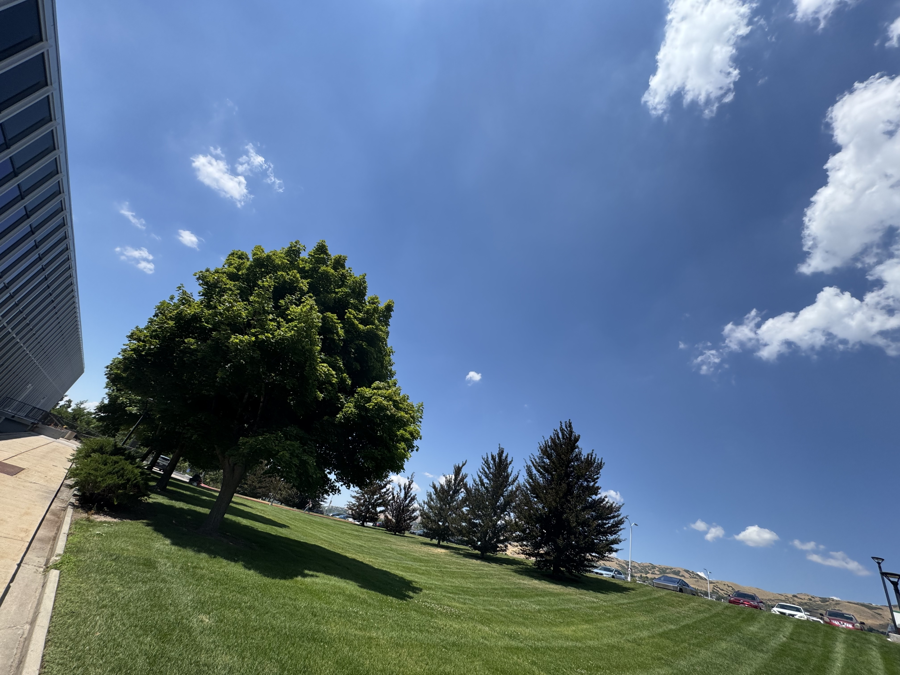

<body>
  

    

      ✕
      
On the academic job market, 2026–27

      
Seeking tenure-track faculty and postdoctoral positions

      

        <a href="research.html" style="display:inline-block;margin:0 4px;padding:6px 14px;border-radius:5px;background:#001f3f;color:#fff;font-size:14px;font-weight:600;text-decoration:none;">Research</a>
        <a href="assets/Ghazal_Abdollahi_CV.pdf" style="display:inline-block;margin:0 4px;padding:5px 14px;border-radius:5px;border:1px solid #001f3f;color:#001f3f;font-size:14px;font-weight:600;text-decoration:none;">Short CV</a>
      

    

  

  
  <canvas id="bgPattern" aria-hidden="true" style="position:fixed;top:0;left:0;width:100%;height:100%;z-index:-1;pointer-events:none;"></canvas>
  
  
  <button id="storyBtn" type="button" aria-label="Read a short story: Between A and B">
    <svg width="24" height="24" viewBox="0 0 24 24" aria-hidden="true"><line x1="4" y1="18" x2="13" y2="21" stroke="#001f3f" stroke-width="1.3" stroke-dasharray="2 2" opacity=".45"/><polyline points="4,18 11,7 20,12" fill="none" stroke="#001f3f" stroke-width="1.6" stroke-linecap="round" stroke-linejoin="round"/><circle cx="4" cy="18" r="2.4" fill="#001f3f"/><circle cx="11" cy="7" r="1.7" fill="#001f3f"/><circle cx="20" cy="12" r="2.4" fill="#001f3f"/></svg>
    Between A and B: a short story
  </button>
  

    

      <button class="x" type="button" id="storyClose" aria-label="Close">✕</button>
      
A data story by Ghazal · Between A and B

      <svg id="storyArt" viewBox="0 0 300 96" aria-hidden="true">
        <g class="g-dots" fill="rgba(0,31,63,0.35)"><circle cx="80" cy="30" r="2.6"/><circle cx="100" cy="74" r="2.6"/><circle cx="150" cy="58" r="2.6"/><circle cx="165" cy="22" r="2.6"/><circle cx="212" cy="72" r="2.6"/><circle cx="232" cy="38" r="2.6"/><circle cx="125" cy="40" r="2.6"/></g>
        <g class="g-many"><polyline points="22,60 100,74 212,72 278,44"/><polyline points="22,60 125,40 232,38 278,44"/><polyline points="22,60 80,30 150,58 232,38 278,44"/><polyline points="22,60 100,74 125,40 165,22 278,44"/><polyline points="22,60 150,58 212,72 278,44"/></g>
        <polyline class="g-try" pathLength="1" points="22,60 100,74 150,58"/>
        <circle class="g-end" cx="150" cy="58" r="4.5" fill="none" stroke="#001f3f" stroke-width="1.2"/>
        <polyline class="g-path" pathLength="1" points="22,60 80,30 165,22 232,38 278,44"/>
        <circle cx="22" cy="60" r="5" fill="#001f3f"/><circle cx="278" cy="44" r="5" fill="#001f3f"/>
        <text x="22" y="84" font-size="11" fill="#001f3f" text-anchor="middle" font-weight="600">A</text>
        <text x="278" y="30" font-size="11" fill="#001f3f" text-anchor="middle" font-weight="600">B</text>
      </svg>
      

      

        

        
<button id="storyBack" type="button">← Back</button><button id="storyNext" type="button">Next →</button>

      

    

  

  
</body>
# PhD Candidate in Computer Science
[University of Utah](https://www.utah.edu/) | [Flux Research Group](https://www.flux.utah.edu/)

## About

I'm a PhD candidate at the [Kahlert School of Computing](https://www.cs.utah.edu/) at the University of Utah (since 2022), where I work with [Prof. Robert Ricci](https://ricci.io) as part of the [Flux Research Group](https://www.flux.utah.edu/). My research is about how computing systems can notice what is forming in their own data early enough to act on it, in a way people can follow. I call this Interpretable Signal-to-Control (O→S→C: observation, signal, control), and I have developed it in serverless computing, data center networking, and network security.

  <strong style="color:#001f3f;">On the academic job market, 2026–27</strong> 
  Seeking tenure-track faculty and postdoctoral positions.

  <a href="research.html" style="display:inline-block;padding:8px 16px;border-radius:5px;background:#001f3f;color:#fff;font-weight:600;text-decoration:none;">Research Overview →</a>
  <a href="assets/Ghazal_Abdollahi_CV.pdf" style="display:inline-block;padding:7px 16px;border-radius:5px;border:1px solid #001f3f;color:#001f3f;font-weight:600;text-decoration:none;">Short CV (PDF)</a>

  
   
  <em>Photo taken at MEB, my office building, Summer 2026.</em>

## ✉️ Contact

**Email**: Ghazal [dot] Abdollahi [at] utah.edu

I'm open to research collaborations in my research areas. Feel free to reach out through my email!

**Status:** seeking tenure-track faculty and postdoctoral positions.

-------------------------------------------------
## 💡 What My Papers Have Taught Me

- **Serverless:** cold starts and idle containers are one problem, not two. Reading how long a function runs and how soon it will be called again lets a platform steady both at once, with rules an operator can read line by line.
- **Data center networking:** flow populations show structure before any single flow can be classified. Following that idea to its limit led me to the "reactive wall", a negative result that taught me more than the cases where the method worked.
- **Security:** SSH logs hold millions of attempts and little direct evidence of intent. Looking at attacker populations instead of single events reveals who is attacking, and when independently trained learners disagree about an attacker, that disagreement is itself an early sign of a campaign in transition.
- **Across all three:** the useful signals took similar shapes in fields that rarely cite one another, which is the question I most want to keep exploring.

The bigger picture is in the [Research Overview](research.md).

-------------------------------------------------
## 📄 Publications

- **Vertex: Towards Recommender Firewalls Resilient to Post-Detection Evasion** — poster, ACM IMC 2026
- **EPIC: When Learners Disagree, Campaigns Speak; Perceiving Structure in Unfolding SSH Episodes** — poster, ACM SIGCOMM 2026
- **Combo: Proactive Momentum and the Reactive Wall** — ACM NetNeg (Workshop on Negative Results in Networking), SIGCOMM 2026
- **WarmFlex: Coordinated Stabilization of Cold-Start Frequency and Idle Containers in Serverless Platforms** — IEEE SmartCloud 2026
- **NOD: Uncovering Intense Attackers' Behavior Through Nested Outlier Detection from SSH Logs** — PRISM Workshop, NDSS 2026
- **Atomic Resolution Mapping and Electrochemical Analysis of Illicit Drug-Aptamer Complexes and Their Terahertz Signatures** — IEEE NMDC 2025
- **FMap: A Fuzzy Map for Scheduling Elephant Flows Through Jumping** — Concurrency and Computation: Practice and Experience
- **Flow-Aware Forwarding in SDN Data Centers Using a Knapsack-PSO-Based Solution** — IEEE Transactions on Network and Service Management

Published papers are also on [Google Scholar](https://scholar.google.com/citations?hl=en&user=d8byHrIAAAAJ).

-------------------------------------------------
## 🎓 Education

- **Ph.D. candidate in Computer Science**, University of Utah, Salt Lake City, UT (Fall 2022 – present). Kahlert School of Computing, Flux Research Group. Advisor: [Prof. Robert Ricci](https://ricci.io).
- **M.Sc. in Information Technology Engineering – Computer Networks**, Salman Institute of Higher Education, Mashhad, Iran
- **B.Sc. in Information Technology Engineering**, Payame Noor University, Iran

## 🏅 Grants & Awards

- **N2Women Travel Grant**, ACM MobiCom 2026, Austin, TX
- **Conference Travel Grants**: ACM RecSys 2026, USENIX PEPR '26, NSDI 2025, KubeCon 2024, and ACM CCS 2024

## 🔬 Experience

- **ML-based Biomedical Detection Intern**, ECE Department, University of Utah (Summer 2024, Summer 2026). Supervisor: [Prof. Massood Tabib-Azar](https://profiles.faculty.utah.edu/u0640514), [AMANDA Lab](https://amanda.ece.utah.edu/people/). I built machine-learning classification for a wearable THC biosensor and brought the model onto a small, resource-limited microcontroller so that it runs on the device itself.

## 🧑‍🏫 Teaching

**Teaching Assistant**, CS 4000 – Senior Capstone Design, University of Utah (Fall 2026). Instructors: Prof. H. James de St. Germain, Prof. David Bean, and Prof. Fengjiao Wang.

Before the semester began I read and ranked close to 200 project proposals for a class of 224 seniors. Then ten of those proposals became my teams, and the ideas had faces. I meet each team for thirty minutes every week and bring the questions I ask of my own research: Does the data this project depends on actually exist? What is new here that existing applications do not already offer? What will be real by the next milestone? Some of the projects have outside sponsors, including WebBank and the Huntsman Cancer Institute, which connects the work to a purpose beyond the classroom.

What these weeks have taught me about teaching:

- **Ask before telling.** A good question leaves the thinking with the team. Some students open up with more questions, and others need fewer of them and more room.
- **Say what counts before the work starts.** With 224 students and five graders, clear expectations are what make feedback fair.
- **Judge a project by what it is becoming.** Teams spend most of a semester with nothing finished to show, and an early verdict can end an idea that was about to become good.
- **Teach the layer above the prototype.** A team can reach a prototype quickly today, so my time goes to what a tool cannot generate: data, novelty, and scope.

**Courses I would love to teach:** Data Mining, Machine Learning, Advanced Artificial Intelligence, Network Security, Computer Networks, and Cloud and Distributed Systems. I would also like to build a project-based course in which students collect their own data and defend what it can and cannot support.

## 🤝 Service

- **Volunteer Reviewer**: IEEE Transactions on Network and Service Management
- **Volunteer Reviewer**: Future Generation Computer Systems (Elsevier)
- **Artifact Evaluation**: ACM SIGMETRICS 2026 (shadow reviewer)
- **Artifact Evaluation**: IEEE ICPE
- **Student Volunteer**: PMAPS 2026, Salt Lake City, UT

-------------------------------------------------
## 🌐 Conferences & Workshops

Conferences, workshops, and summits I have **presented/attended** at:
- **ACM MobiCom 2026** — Austin, TX, USA *(N2Women Travel Grant)*
- **ACM RecSys 2026** — Minneapolis, Minnesota, USA
- **PMAPS 2026** — Salt Lake City, UT, USA *(Student Volunteer)*
- **SIGCOMM 2026** — Denver, Colorado, USA
- **AI Convergence Summit 2026** — University of Utah, SLC, UT, USA 
- **USENIX PEPR '26** — Santa Clara, CA, USA
- **IEEE SmartCloud 2026** — NYC, New York City, USA
- **NDSS 2026** — San Diego, CA, USA
- **ACM HotNets 2025** — University of Maryland, MD, USA  
- **NSDI 2025** — Philadelphia, PA, USA  
- **AI Summit 2025** — University of Utah, Salt Lake City, UT, USA  
- **KubeCon 2024** — Salt Lake City, UT, USA  
- **ACM CCS 2024** — Salt Lake City, UT, USA  
- **ML & Big Data HPC Workshop** — INSCC, University of Utah, USA

-------------------------------------------------
## 🛠 Key Skills

Cloud and serverless computing · container orchestration · cold-start and idle-resource optimization · data center networking · software-defined networking (SDN) · flow scheduling and forwarding · AI/ML for networking and security · interpretable/explainable AI · anomaly and intrusion detection · attacker behavior and security log analysis · workload characterization · embedded and edge machine learning

-------------------------------------------------
## 🎣 A Quote I Keep Close

I love how this quote makes sense in my research process:
  "It goes always, bit by bit. You don't see the whole thing at once.
  The way it unfolds is anybody's guess. It's kind of a magical thing.
  But eventually, it gets there. If you focus on it, it'll draw other
  ideas in. And... but you don't know. Like fishing, you have to have
  patience. You don't know how long it'll take. But if you keep
  focusing on it, it'll... and wiggle the line a little bit, it'll
  bring them in. Intuition is the intellect and emotions swimming
  together." — David Lynch

-------------------------------------------------
## 📍 Salt Lake City, Utah, USA

Salt Lake City is a quiet mountain city surrounded by peaceful scenery and genuinely nice people. You’re only minutes to hours from spectacular landscapes; national parks like [Yellowstone](https://www.nps.gov/yell/index.htm) (not in Utah, but much closer from here), lakes such as Mirror Lake and Silver Lake, and many outdoor trails. It’s an ideal place for a PhD student who wants to live close to nature and far from the hustle and bustle of a crowded city.

## 📸 Gallery
Here are photos I took during my visit to Yellowstone in Spring 2025:
[Yellowstone — Spring 2025](gallery.html)

-------------------------------------------------

## 🧘 Outside of Research

Yoga and meditation are how I reset. I practice regularly at CorePower Yoga, where Core Restore is my favorite class, and I love a good sound bath. They keep me grounded, and they remind me that clarity comes from stillness as much as from effort.

-------------------------------------------------

## 📖🎧 Recent favorite Books & Podcasts
- **[The Let Them Theory — Mel Robbins](https://www.melrobbins.com/book/the-let-them-theory/)**  
  _A practical lens on agency, focus, and action in complex work and life._

- **[The Diary Of A CEO](https://www.youtube.com/channel/UCGq-a57w-aPwyi3pW7XLiHw)**  
  _Long-form conversations about motivation, leadership, and personal evolution._

- **[Effortless — Greg McKeown](https://www.amazon.com/Effortless-Make-Easier-What-Matters/dp/B08FMTSZLN/)**  
  _A guide to making the most important work feel lighter, not harder._

- **[Being the Best (Behtarin Boodan) – Masoud Malekyari](https://ketabrah.com/book/60237)**  
  _A little flute loses its notes and creates a new song. Great work is not made from perfect conditions, but from turning limits into new strengths._

-------------------------------------------------
